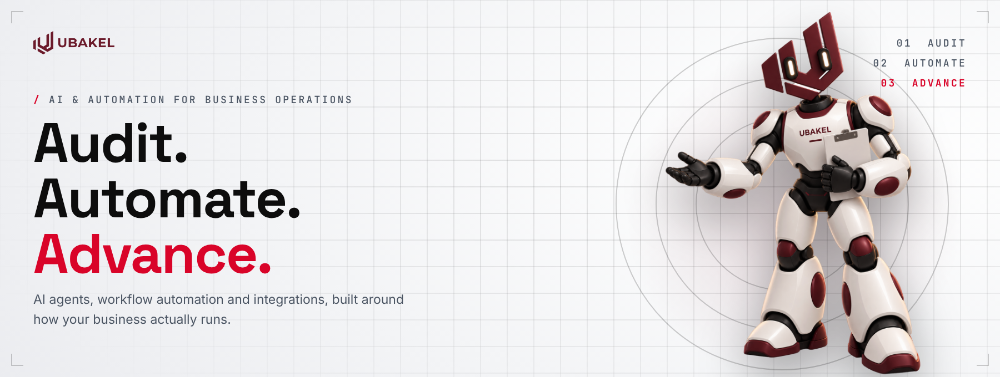
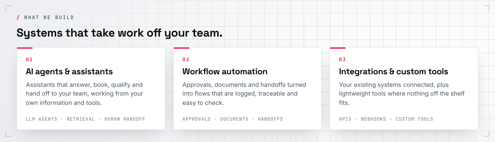
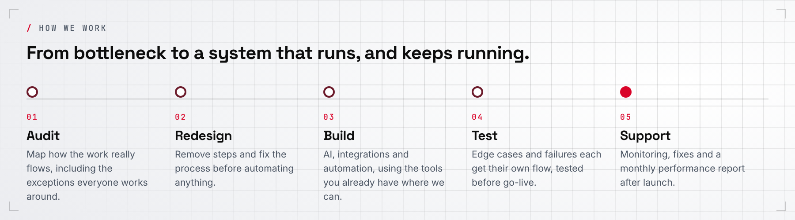
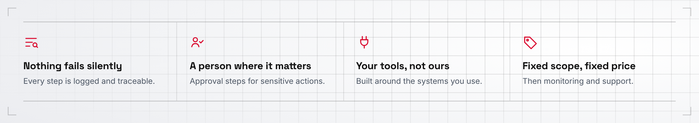
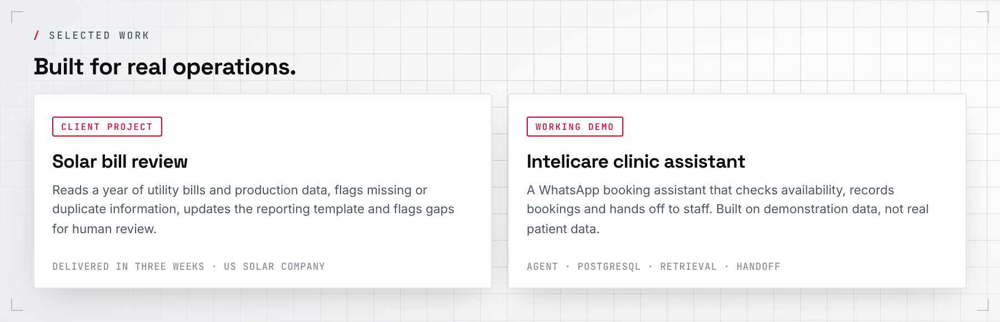
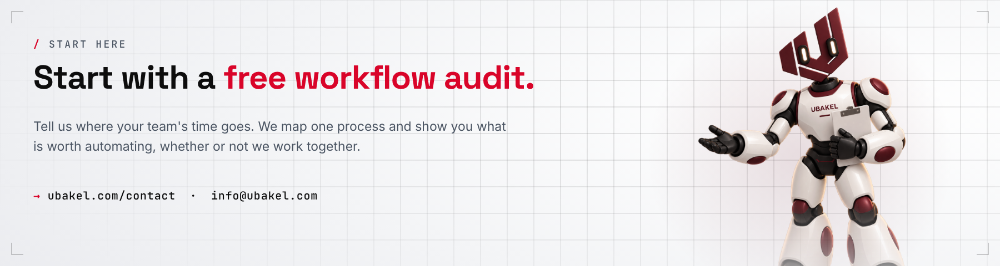

  <a href="https://ubakel.com">
    <picture>
      <source media="(prefers-color-scheme: dark)" srcset="assets/banner-dark.png">
      
    </picture>
  </a>

  <a href="https://ubakel.com"><b>ubakel.com</b></a> &nbsp;·&nbsp;
  <a href="https://ubakel.com/contact/">Free workflow audit</a> &nbsp;·&nbsp;
  <a href="mailto:info@ubakel.com">info@ubakel.com</a> &nbsp;·&nbsp;
  <a href="https://www.linkedin.com/company/ubakel/">LinkedIn</a>

  AI &amp; Automation for Business Operations &nbsp;·&nbsp; Operations &nbsp;·&nbsp; Finance &nbsp;·&nbsp; Customer support &nbsp;·&nbsp; Sales &amp; admin

  <picture>
    <source media="(prefers-color-scheme: dark)" srcset="assets/what-we-build-dark.png">
    
  </picture>

  <picture>
    <source media="(prefers-color-scheme: dark)" srcset="assets/approach-dark.png">
    
  </picture>

  <picture>
    <source media="(prefers-color-scheme: dark)" srcset="assets/principles-dark.png">
    
  </picture>

  <picture>
    <source media="(prefers-color-scheme: dark)" srcset="assets/selected-work-dark.png">
    
  </picture>

  
    Open work: <a href="https://github.com/ubakel/whatsapp-clinic-booking-assistant">Ubakel Front Desk</a> &nbsp;·&nbsp;
    <a href="https://github.com/ubakel/ap-invoice-automation-engine">AP invoice engine</a> &nbsp;·&nbsp;
    <a href="https://github.com/ubakel/solar-report-automation">Solar report automation</a> &nbsp;·&nbsp;
    <a href="https://github.com/ubakel/finance-os-notion">Finance OS</a> &nbsp;·&nbsp;
    <a href="https://github.com/ubakel/ubakel-web">ubakel.com source</a>
  

  <a href="https://ubakel.com/contact/">
    <picture>
      <source media="(prefers-color-scheme: dark)" srcset="assets/cta-dark.png">
      
    </picture>
  </a>

